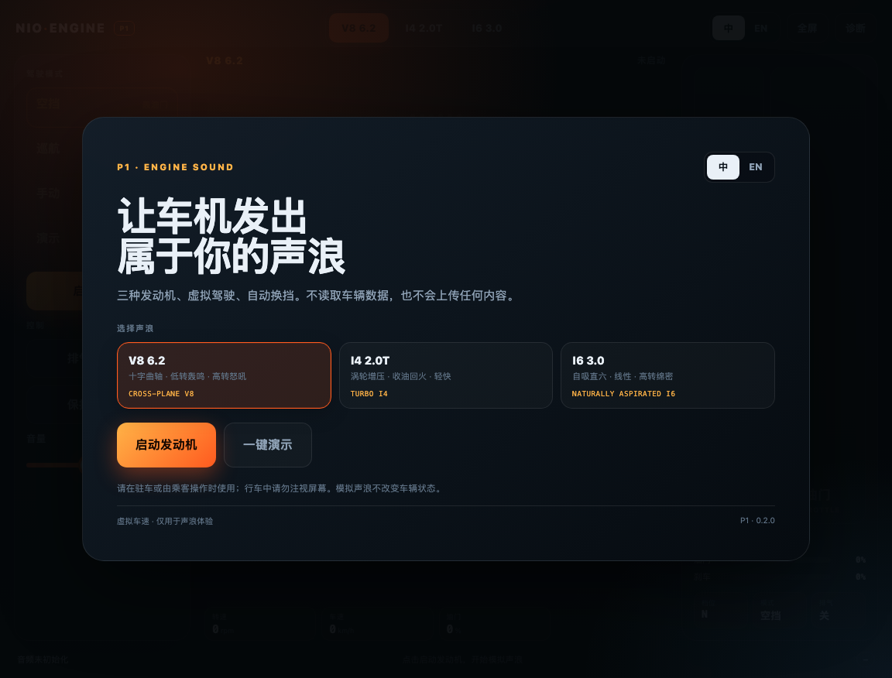
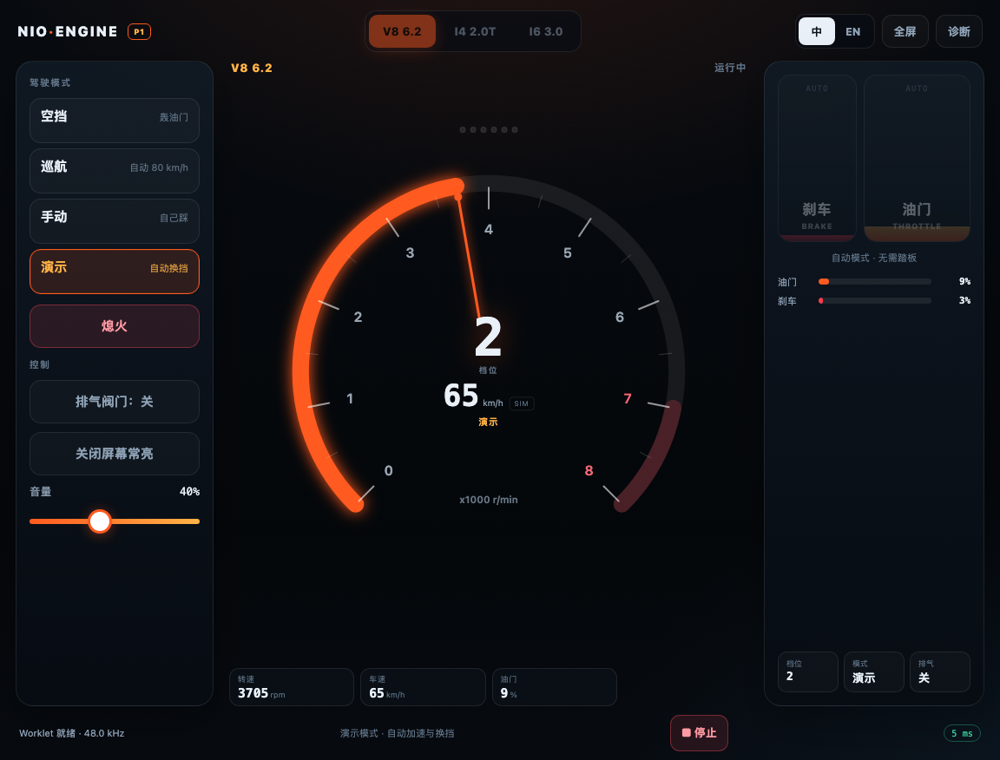

# nioengine P1 · 车机模拟声浪

P1 是面向车机浏览器的**虚拟发动机声浪应用**。它不读取车辆数据，用页面内的虚拟驾驶模型驱动发动机转速、档位、车速和声浪；支持 3 种发动机、4 种驾驶模式、自动换挡、涡轮、回火、限转、排气阀门和车厢混响。





> 截图按车机视口 1152 × 876 渲染；实际字体和间距以真车为准。

---

## 快速开始

```bash
npm run build:p1     # 生成 p1/dist/index.html + p1/dist/engine-worklet.js
npm run serve:p1     # http://127.0.0.1:4174
```

P1 版本：`0.2.0`。

### 部署

把这两个文件上传到**同一个 HTTPS 目录**：

```text
/var/www/nioengine-p1/
├── index.html
└── engine-worklet.js
```

- `index.html` 是单文件应用（CSS / JS / Worklet 源码内联）。
- `engine-worklet.js` 是 Blob 加载失败时的同源备用路径，建议一起上传。
- `.js` MIME 必须是 `application/javascript`。
- 必须 HTTPS；非安全上下文下 Worklet 会被浏览器禁用，页面会退化为简单锯齿波。
- P1 与 P0 可以部署在同一个域名下的不同路径（如 `/` 和 `/p0/`），互不影响。

Nginx 示例：

```nginx
server {
    listen 443 ssl http2;
    server_name your-domain.example.com;
    root /var/www/nioengine-p1;

    location / {
        try_files $uri $uri/ /index.html;
        add_header Cache-Control "no-store";
    }

    location = /engine-worklet.js {
        default_type application/javascript;
        add_header Cache-Control "no-store";
    }
}
```

---

## 启动与操作

打开页面会看到启动页：

1. 选择声浪：**V8 6.2 / I4 2.0T / I6 3.0**。
2. 点 **启动发动机**：起动机 → 点火 → 怠速（空挡）。
3. 点 **一键演示**：直接进入自动演示，适合快速展示。

驾驶舱：

| 区域 | 操作 |
|---|---|
| 左侧模式 | **空挡**（轰油门）、**巡航**（自动 80 km/h）、**手动**（踏板）、**演示**（自动 0→130→0） |
| 左侧控制 | 排气阀门开/关、屏幕常亮、音量 |
| 中央 | 转速表、档位、虚拟车速、油门/涡轮读数、换挡灯 |
| 右侧 | 刹车 / 油门踏板（手动 & 空挡可用），油门/刹车/涡轮条，档位/模式/排气状态 |
| 顶部 | 声浪切换（运行中锁定）、中/英、全屏、诊断 |
| 底部 | 音频状态、模式提示、停止、上报延迟 |

键盘（桌面调试）：`Space` 油门、`B` 刹车、`F` 全屏、`Esc` 停止。

---

## 三种声浪

| 预设 | 结构 | 特征 |
|---|---|---|
| **V8 6.2** | 8 缸十字曲轴，1-8-7-2-6-5-4-3 | 低转轰鸣、二/四阶与半阶、高转怒吼 |
| **I4 2.0T** | 4 缸，1-3-4-2 | 涡轮哨音、收油回火、轻快 |
| **I6 3.0** | 6 缸，1-5-3-6-2-4 | 自吸直六、线性、高转绵密 |

运行中不能切换声浪，先“熄火”再换；这是为了避免切换时爆音和参数重置。

---

## 声音架构

- **曲轴角点火事件**：每个缸按点火顺序在 720° 循环中触发脉冲，不是简单振荡器。
- **双排气 bank**：左右 bank 独立共振，V8 的 bank 不均匀产生十字曲轴 rumble。
- **排气共振器**：每个 bank 3 个带通共振器 + 时变低通，形成排气音色。
- **进气噪声**：带通白噪声 + 低频 roar，随转速/负载变化。
- **涡轮**：I4 有 boost 哨音和收油 blow-off。
- **回火/爆震**：收油高转时随机 pop；换挡有 cut + pop。
- **限转**：超过 limiter 时断油抖动。
- **起动机/熄火**：起动机 whine + 不规则 crank → catch；熄火 run-down。
- **车厢**：原生 `ConvolverNode`（合成短 IR）+ EQ + 压缩/限幅。
- **排气阀门**：改变亮度/输出，作为音色开关。

---

## 虚拟驾驶

浏览器拿不到车速/转速/油门，所以 P1 的“行驶”是页面内的虚拟驾驶：

- 自动变速箱：根据转速、油门、车速换挡；轻油早换、全油高转换。
- 巡航：PI 控制目标 80 km/h。
- 演示：32 秒循环，0 → 60 → 130 → 100 → 50 → 0 km/h。
- 手动：按住油门/刹车，自动换挡；空挡可原地轰油门。
- 空挡带速：车速滑行，发动机回到怠速/油门转速。

**P1 的虚拟车速只用于声浪体验**，不代表真实车辆状态。

---

## 诊断

右上角 **诊断** 打开抽屉，显示：

- Worklet 状态 / 加载方式（blob/url）/ HTTPS 阻止
- AudioContext 状态、采样率
- 浏览器上报的 base/output 延迟
- 心跳次数、最近间隔、最大间隔
- FPS、发动机状态、声浪、模式、车速、档位
- 可复制诊断 JSON

开发参数：

- `?autostart=demo` / `?autostart=cruise` / `?autostart=manual` / `?autostart=1`
- `?lang=zh` / `?lang=en`
- 控制台 `window.__P1__` 可读状态、启动/停止、切模式/声浪、看频谱。

---

## 已知限制

- **输出延迟约 98 ms**（P0 真车上报 10 + 88 ms）。P1 用连续虚拟驾驶和转速平滑弱化，但瞬时“踩下就轰”仍会略慢；这是车机音频 HAL 决定的，Worklet 不能降低。
- **不是真实车辆联动**：没有 CAN/SDK，P1 是自驱模拟。真实联动需要原生/OEM 方案（本项目明确不做）。
- **没有手动换挡**：P1 只做自动变速箱；手动拨片留到后续。
- **工作声浪是合成模型**，需要在真车上按听感继续调音；频谱结构对，但音色、音量、低频/ANC 表现要实车确认。
- **Worklet 不可用时**会退化为简单锯齿波，只保证有声音；完整声浪需要 HTTPS + Worklet。
- 未做完整的 10 分钟自动稳定性报告；可以长按演示/巡航跑，配合诊断面板观察心跳与 FPS，或继续用 P0 做长稳测试。

---

## 真车测试清单

1. 打开 HTTPS 页面，确认启动页和三个声浪卡片正常；试听 V8 / I4 / I6。
2. 启动后先空挡轰油门，确认怠速、拉转、收油回火。
3. **巡航**：自动加速到 80 km/h，观察换挡和转速；**演示**：完整看 32 秒循环。
4. **手动**：按住油门/刹车，确认加速、自动升挡、刹车降挡、停车。
5. 试排气阀门、音量、全屏、屏幕常亮。
6. 旋转横竖屏，确认布局与可读性。
7. 长跑 10 分钟，观察诊断里的心跳、最大间隔、FPS；记录任何断音/爆音。
8. 用手机录一段车内视频（V8 怠速/拉转、I4 涡轮、I6 高转、演示换挡），回传做调音依据。

---

## 文件

```text
p1/
├── index.html          页面结构
├── styles.css          车机 cockpit UI
├── i18n.js             中 / 英
├── app.js              虚拟驾驶、UI、音频图、诊断
├── engine-worklet.js   发动机合成 Worklet
├── build.mjs           内联构建
├── docs/               截图
└── dist/               构建产物（gitignore）
```

P0 能力探测仍在仓库根目录，保留用于 HTTPS/Worklet/延迟/长稳诊断。
