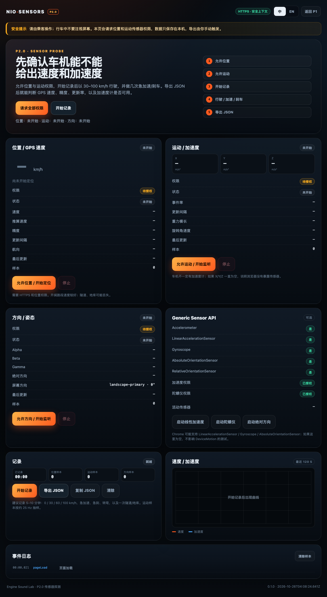

# P2.0 传感器探测

这是上车前的“传感器能力探测页”，不是声浪应用。目标是回答：

- 车机浏览器能不能拿到 **GPS 速度**（`coords.speed`）？
- `DeviceMotion` / `DeviceOrientation` 是否可用？更新率、轴向、重力值是多少？
- Generic Sensor API（`LinearAccelerationSensor` / `Gyroscope` / `AbsoluteOrientationSensor`）是否可用？
- 位置/运动权限能否在 NioBrowser 里授予？切后台后是否恢复？
- 实际行驶时，GPS 速度和加速度数据是否足以驱动声浪？

页面不上传数据。样本只保存在当前标签页，点“导出 JSON”才离开浏览器。



---

## 本地构建

```bash
npm run build:p2     # p2-probe/dist/index.html
npm run serve:p2     # http://127.0.0.1:4177
```

单文件，无外部依赖，无 Worklet。

## 部署

Cloudflare Worker 的 `npm run build:all` 会自动组装到：

```text
public/sensors/index.html
```

部署后打开：

```text
https://nioengine.com/sensors/
```

不需要单独上传文件；P1/P0/P2 在同一个 Worker 里。

---

## 真车测试步骤

1. 停车或由副驾操作，打开 `/sensors/`。
2. 点 **请求全部权限**；如果车机分别弹窗，就分别点 **允许位置** / **允许运动**。
3. 确认“位置 / GPS 速度”出现 `定位中`，运动卡出现 `监听中`，且 X/Y/Z 有数值。
4. 点 **开始记录**。
5. 行驶 5–10 分钟，覆盖：
   - 0 / 30 / 60 / 100 km/h 匀速；
   - 2–3 次急加速；
   - 2–3 次急刹/收油；
   - 1–2 次转弯；
   - 如果有条件，过一次隧道/地库，观察丢星。
6. 回到页面，点 **停止记录**。
7. 点 **导出 JSON**，把文件发回来；也可以先看页面上的汇总。即使没有采到样本，也可以导出“支持矩阵 + 权限 + 事件”报告，用来判断车机是否根本没有传感器。
8. 如果权限被拒绝、传感器一直为空、或页面切后台后数据停止，也请记录在备注里。

> 行车中不要看屏幕；测试由乘客操作，或停车设置好再行驶。

---

## 页面怎么读

### 位置 / GPS 速度

- **速度**：优先用浏览器的 `coords.speed`（多普勒速度），为空时用相邻定位点距离/时间推算。
- **精度**：`coords.accuracy`，单位米；越大越差。
- **更新间隔**：相邻定位点的间隔，通常 1000 ms 左右。
- **样本**：本次记录收到的定位点数，不是总回调数。
- **状态**：`定位中` 表示 watch 已启动；`错误` 表示权限/超时/无定位。

如果速度一直 `—`，但定位点有更新，说明浏览器只给了位置、没给速度；这时只能靠推算或 IMU。

### 运动 / 加速度

- X/Y/Z 是设备坐标轴，不是车辆坐标；需要后续做轴向标定。
- **重力模长** 接近 9.8 m/s² 说明 `accelerationIncludingGravity` 正常。
- **事件率** 是最近 1 秒的 `devicemotion` 频率；车机可能只有 10–30 Hz。
- 如果一直 `—`，说明浏览器没有暴露运动传感器，GPS-only 方案是唯一选择。

### Generic Sensor API

- `LinearAccelerationSensor`：去重力线性加速度，最适合做车辆纵向加速度。
- `Gyroscope`：角速度，可用于转弯/姿态辅助。
- `AbsoluteOrientationSensor`：绝对姿态四元数，可用于轴向校准。
- 有支持不代表有权限；点按钮启动后看“活动传感器”和读数。

---

## 报告内容

`sensors-*.json` 包含：

- `geolocation.samples`：时间、速度、`coords.speed`、推算速度、精度、航向、间隔；
- `motion.samples`：约 25 Hz 抽样的三轴加速度、含重力加速度、旋转角速度、间隔；
- `orientation.samples`：约 10 Hz 的 alpha/beta/gamma；
- 汇总：速度范围/均值、精度均值、更新间隔、加速度范围、重力均值；
- 支持矩阵、权限、设备/视口、事件日志。

**不包含经纬度**，避免位置隐私；只保留速度、精度、航向。

---

## 判定标准

| 结果 | 结论 |
|---|---|
| GPS 有速度 + Motion 有数据 | 可以做 GPS+IMU 融合，响应最好 |
| GPS 有速度，Motion 为空 | 做 GPS-only；速度匹配可以，瞬态会慢 |
| GPS 无速度，只有位置 | 只能用位置推算，噪声大，不推荐直接做声浪 |
| GPS 和 Motion 都不可用 | 浏览器拿不到真实车速；保留虚拟驾驶或另做手机伴侣 |

---

## 已知限制

- 这是浏览器传感器探测，不是 CAN/OBD；没有真实档位、转速、油门。
- GPS 在隧道/地库会丢失；IMU 积分会漂移，后续必须用 GPS 校正。
- 车机浏览器可能限制后台传感器；页面切后台后数据可能暂停。
- `coords.speed` 在部分设备上为 `null`；推算速度对定位抖动敏感。
- 页面数据只在本机；刷新/关闭会丢失未导出的样本。

---

## 调试

页面暴露调试对象（用于无头测试/开发，不建议在真车使用）：

```js
window.__SENSORS__.state
window.__SENSORS__.buildReport()
window.__SENSORS__.injectGeo({ speedMps: 20, accuracy: 5 })
window.__SENSORS__.injectMotion({ ax: 1.2, ay: 0, az: 0, agx: 1.2, agy: 0, agz: 9.8 })
```

注入的样本会在报告里标记 `"mock": true`。
