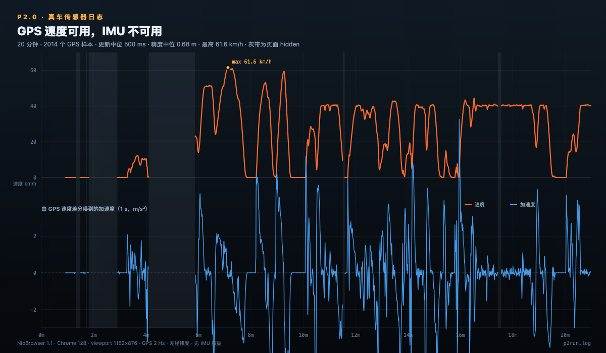

> 2026-10-26：本报告的结论已落地为 **P2.1**，P1 0.3.0 新增 GPS 驱动模式（GPS-only，无 IMU 融合）。

# P2.0 真车日志分析

**日志**：`p2run.log`  
**采集时间**：2026-10-26 12:13–12:34（本地）  
**页面**：`https://nioengine.com/sensors/`  
**车机**：NioBrowser 1.1 / Chrome 128 / Linux  
**视口**：1152×876，screen 1920×1200，DPR 1.5  
**记录时长**：1204.9 s（约 20 分 05 秒）  
**样本**：2014 个 GPS 点；Motion 6 个；Orientation 6 个



---

## 结论

**GPS 速度可用，而且质量很好；IMU 不可用。下一步只能做 GPS-only，不做 GPS+IMU 融合。**

- `geolocation` 全部 2014 个样本都有速度，没有 `null`；2 Hz 更新；精度中位 **0.68 m**，p95 **2.51 m**。
- `coords.speed` 与相邻点推算速度的平均绝对差 **0.49 km/h**，p95 **1.39 km/h**，说明 GPS 速度可信。
- Motion / Orientation 虽然 API 存在，但 20 分钟只产生了 **6 个全 null 的事件**，且都发生在页面从 hidden 回到 visible 的瞬间；没有可用加速度。
- Generic Sensor API 三个传感器都“支持”，但启动全部报 `Could not connect to a sensor`；这是 API 存在但硬件/浏览器没有真正暴露传感器的典型情况。
- 因此：**速度用 GPS；加速度用 GPS 速度差分**。1 s / 2 s 差分已经足够驱动负载和换挡，但会有约 1–2 s 的滞后。

---

## 1. GPS 数据

| 指标 | 结果 |
|---|---|
| 样本数 | 2014 |
| 记录时长 | 1204.9 s |
| 更新间隔中位 | 500.3 ms（约 2 Hz） |
| 更新间隔 p95 | 519.6 ms |
| `coords.speed` 缺失 | 0 |
| 速度范围 | 0–61.56 km/h |
| 平均速度 | 25.41 km/h |
| 精度中位 / p95 | 0.68 m / 2.51 m |
| GPS 速度 vs 推算速度 | 平均绝对差 0.49 km/h；p95 1.39；最大 2.34 |

速度分布：

| 区间 | 样本 |
|---|---:|
| 0–1 km/h | 388 |
| 1–5 | 87 |
| 5–10 | 112 |
| 10–20 | 233 |
| 20–30 | 182 |
| 30–40 | 365 |
| 40–50 | 510 |
| 50–60 | 106 |
| 60–70 | 31 |

这次路线以城市道路为主：最高 61.6 km/h，40–50 km/h 占最大比例，没有 100 km/h 以上数据。

### 停车与零速

共 11 段速度 <1 km/h，全部是真正的停车/等灯，不是 GPS 假零：

- 最长停车 142.0 s；
- 其余包括 23.5 s、34.5 s、8.0 s、11.0 s、31.5 s 等；
- 没有发现“速度突然掉到 0、下一帧又回到 40 km/h”的孤立假零；
- 也没有发现 `gpsSpeed < 1 km/h` 而 `derivedSpeed > 5 km/h` 的矛盾点。

这点很关键：GPS 速度可以直接用于停车/怠速判断，不需要额外做零速剔除，但仍建议保留中值/限幅保护。

---

## 2. 加速度质量

由 GPS 速度差分得到：

| 方法 | 最小值 | p95 绝对值 | 最大值 | 说明 |
|---|---:|---:|---:|---|
| 原始相邻点差分 | -2.53 m/s² | 约 1.0 | +2.72 m/s² | 噪声较大，但可用 |
| 1 s 窗口 | -2.46 m/s² | 0.98 | +2.33 m/s² | 推荐主用 |
| 2 s 窗口 | -2.30 m/s² | 0.96 | +2.00 m/s² | 更平滑，换挡/负载更稳 |

停车状态（<1 km/h）的 1 s 差分噪声：

- 均值约 0.06 m/s²；
- 标准差约 0.26 m/s²；
- p95 绝对值约 0.43 m/s²；
- 因此停车时加一个 **±0.25–0.35 m/s² 死区**，就可以稳定保持怠速，不会被 GPS 噪声触发油门/回火。

行驶状态（≥1 km/h）的 1 s 差分：

- 标准差约 0.58 m/s²；
- p95 绝对值约 1.30 m/s²；
- 最大约 2.46 m/s²。

对声浪来说，这个范围足够区分：

- 轻微加速 / 巡航；
- 中等加速；
- 大油门；
- 收油/刹车。

不足是**响应速度**：GPS 2 Hz，加上 1–2 s 平滑，负载变化会比真实油门慢 1–2 s。再叠加 98 ms 音频输出延迟，总滞后约 **1.1–2.1 s**。这适合连续速度匹配，不适合“踩下立即轰”的瞬时反馈。

---

## 3. Motion / Orientation：API 存在但不可用

`support` 里 `deviceMotion: true`、`deviceOrientation: true`，但实际数据：

- Motion 样本：6 个；
- Orientation 样本：6 个；
- 所有 `ax/ay/az/agx/agy/agz/ra/rb/rg/alpha/beta/gamma` 都是 `null`；
- 6 个 Motion 样本都发生在页面从 hidden 变为 visible 的瞬间（88.5、104.5、174.1、352.1、695.1、1053.8 s）；
- `intervalMs` 都是 16，但没有有效读数。

这说明 NioBrowser 暴露了 `DeviceMotionEvent` / `DeviceOrientationEvent` 接口，但车机没有向页面提供真正的传感器数据。**不能做 IMU 积分、轴向标定或 GPS+IMU 融合。**

Generic Sensor API 同样是假阳性：

```text
LinearAccelerationSensor   → Could not connect to a sensor
Gyroscope                  → Could not connect to a sensor
AbsoluteOrientationSensor  → Could not connect to a sensor
```

权限状态里 `accelerometer` / `gyroscope` / `magnetometer` 都是 `granted`，但权限通过 ≠ 有数据。以后判断传感器不能只看权限或 API 是否存在，必须看“有效读数”。

---

## 4. 页面 hidden 导致 GPS 中断

6 次 >2 s 的 GPS 间隔：

| 起始 → 结束 | 间隔 | 速度变化 | 与 hidden 重叠 |
|---|---:|---:|---|
| 78.4 → 88.9 s | 10.5 s | 0 → 0 km/h | 是 |
| 102.4 → 104.9 s | 2.5 s | 0 → 0 km/h | 是 |
| 107.9 → 174.4 s | 66.5 s | 0 → 0 km/h | 是 |
| 245.4 → 352.4 s | 107.0 s | 0.4 → 23.1 km/h | 是 |
| 689.9 → 695.4 s | 5.5 s | 9.7 → 0.1 km/h | 是 |
| 1045.4 → 1054.0 s | 8.6 s | 40.1 → 40.3 km/h | 是 |

规律非常明确：**页面 hidden 时 GPS 暂停，visible 后恢复**。最长一次 107 s 的间隙里，速度从 0.4 变成 23.1 km/h，恢复时不能直接跳变。

GPS-only 产品必须处理：

- hidden 后不再对加速度做积分（本来也没有 IMU）；
- 短间隙（<3 s）保持最后速度，置信度降低；
- 长间隙（>5 s）或 hidden 时淡出到怠速/低负载；
- visible 恢复后，用 1–2 s 平滑把速度拉回新值，不要瞬间跳；
- UI 显示“GPS 信号中断/恢复”，不要伪装成实时。

---

## 5. 可行性判断

| 项目 | 结论 |
|---|---|
| GPS 速度 | **通过**，2 Hz，0.68 m 中位精度，速度无缺失 |
| GPS 加速度 | **可用**，1–2 s 差分，噪声可接受 |
| DeviceMotion 加速度 | **不可用**，全 null |
| Generic Sensor | **不可用**，全部连接失败 |
| GPS+IMU 融合 | **不做** |
| 98 ms 音频延迟 | 已知；叠加 1–2 s 负载滞后 |
| 瞬时“踩下就轰” | 做不到；连续驾驶/巡航可以 |

**最终方案：GPS-only 速度驱动 + 虚拟变速箱 + 加速度差分负载。**

---

## 6. 推荐的 P2.1 实现

### 数据层

```text
Geolocation.watchPosition (2 Hz)
  → 速度有效性检查（accuracy、跳变、零速确认）
  → 速度插值到 20–30 Hz 控制循环
  → 1 s / 2 s 差分得到加速度
  → {speedMps, accelMps2, confidence, lastFixAt}
```

规则：

- `speedMps` 直接用 `coords.speed`，它是这次日志里最可靠的值；
- 相邻 GPS 点推算速度只用于校验，不作为主值；
- 速度跳变 > 15 km/h / 0.5 s 且下一帧恢复 → 视为异常，保持上一帧；
- 停车：连续 2–3 个样本 <1 km/h 才进入怠速，避免单点噪声；
- 加速度死区 ±0.3 m/s²；超过死区才映射负载；
- 1 s 差分用于“攻击/负载”，2 s 差分用于“稳定巡航/换挡”，两者加权；
- GPS 间隙 >2 s 不计算加速度；>5 s 淡出。

### 车辆模型

- 当前 P1 的虚拟变速箱保留；
- 速度 → 档位/RPM；加速度 → 负载/油门/回火；
- 换挡点用速度阈值 + 迟滞 + 加速度修正；避免 GPS 噪声导致频繁换挡；
- 0–61.6 km/h 的数据足够验证 1–3 挡；更高速度用虚拟齿比外推；
- 不需要真实档位/CAN。

### UI

- 新增“GPS 驱动”模式；
- 显示真实 GPS 速度、精度、更新率、信号状态；
- 去掉原来的 `SIM` 车速标记（在该模式下）；
- GPS 丢失/页面 hidden 时显示“信号弱/中断”，声音淡出或保持；
- 保留虚拟驾驶作为 fallback，GPS 不可用时一键回退。

### 验证

- 用 `p2run.log` 做离线回放：把 2014 个速度点按时间喂给车辆模型，检查换挡、RPM、负载是否平滑；
- 真车再跑一次 0–100 km/h（如果安全）和一次隧道/地库；
- 记录视频，确认声音和车速/加速度的主观匹配。

预计 P2.1 实现 + 离线回放 **2–3 天**，实车调音另算。

---

## 7. 这次日志的局限

- 只有一台车、一条城市路线，最高 61.6 km/h；
- 没有 100 km/h 以上、没有隧道/地库（GPS 丢失主要来自 hidden，不是隧道）；
- 没有独立的速度表参考，无法量化 GPS 速度与车机表速的绝对偏差；
- 页面多次 hidden，Motion/Geolocation 都受影响；
- 20 分钟不足以评估长时间漂移，但 GPS 是绝对速度，不存在 IMU 积分漂移。

这些不影响“GPS 可用、IMU 不可用”的结论，但高速档位和隧道策略还需要一次补充测试。
